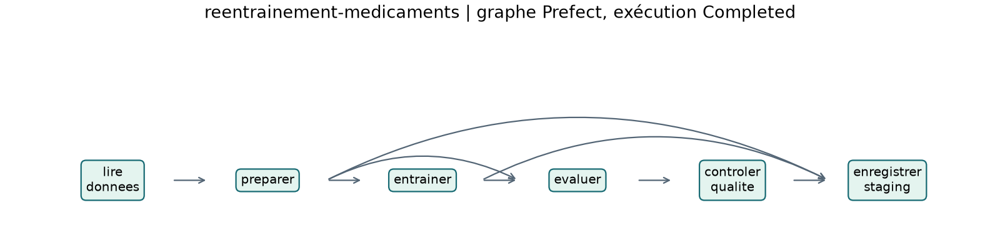

# Phase E — Réentraînement automatisé

## E1 — Graphe et états du flux

Le flux `reentrainement-medicaments` lit le classeur, prépare et sépare les données, entraîne, évalue, contrôle le F1 puis enregistre sous `staging`. Le graphe est reproduit à partir des nœuds et liens réellement retournés par l'API Prefect.

L'exécution normale V2 se termine **Completed**, F1 **0,768683**, et place la version **3** sous `staging`. Avec une profondeur de 2, `controler-qualite` échoue avec « Modele refuse : F1 0.344948 < seuil 0.65. ». L'état final est **Failed** et l'enregistrement n'est pas atteint. [Exécution normale](e1-preuve-normal.json) · [Exécution refusée](e1-preuve-profondeur-2.json)

## E2 — Planification mensuelle

Le déploiement `mensuel` est actif avec l'expression **`15 3 1 * *`**, dans le fuseau **Africa/Casablanca**. Le serveur Prefect a créé une exécution **Scheduled le 1er décembre 2026 à 03 h 15**. Le runner se lance par `python flows/preuves_prefect.py --servir`. [Déploiement et exécution planifiée](e2-planification.json)

## E3 — Fichier indisponible

Le classeur V2 a été déplacé temporairement. Le journal montre **trois lectures** pour une exécution initiale et **deux réessais** espacés de deux secondes. La tâche `lire-donnees` puis le flux terminent **Failed**, avec `FileNotFoundError`. Le classeur a été remis à son chemin d'origine et son SHA-256 vérifié après l'essai. [États et journal](e3-preuve.json)

## E4 — Surveillance Node-RED

Les nœuds suivent cet ordre. **Inject** envoie la requête toutes les 60 s. **HTTP Request** envoie un POST à `127.0.0.1:8000/invocations`. **Switch** teste si la première prédiction vaut 1. **Change** construit l'alerte et **Debug** l'affiche dans le panneau et dans le journal. Le service a déclenché deux alertes à une minute d'intervalle pour le médicament personnel. [Flux exporté](../nodered/remboursement.json) · [Journal du service](e4-alerte.txt)
