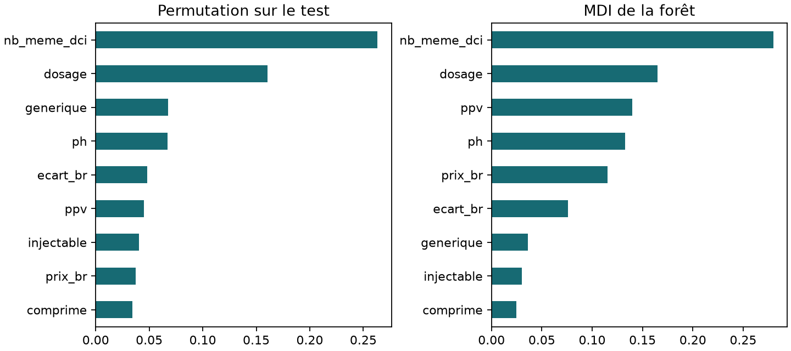
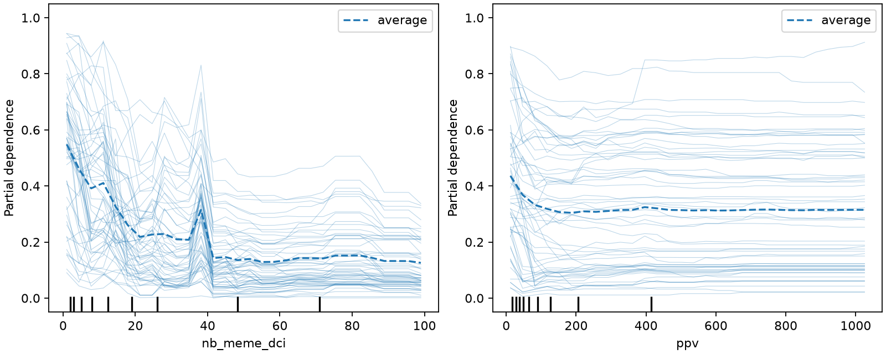
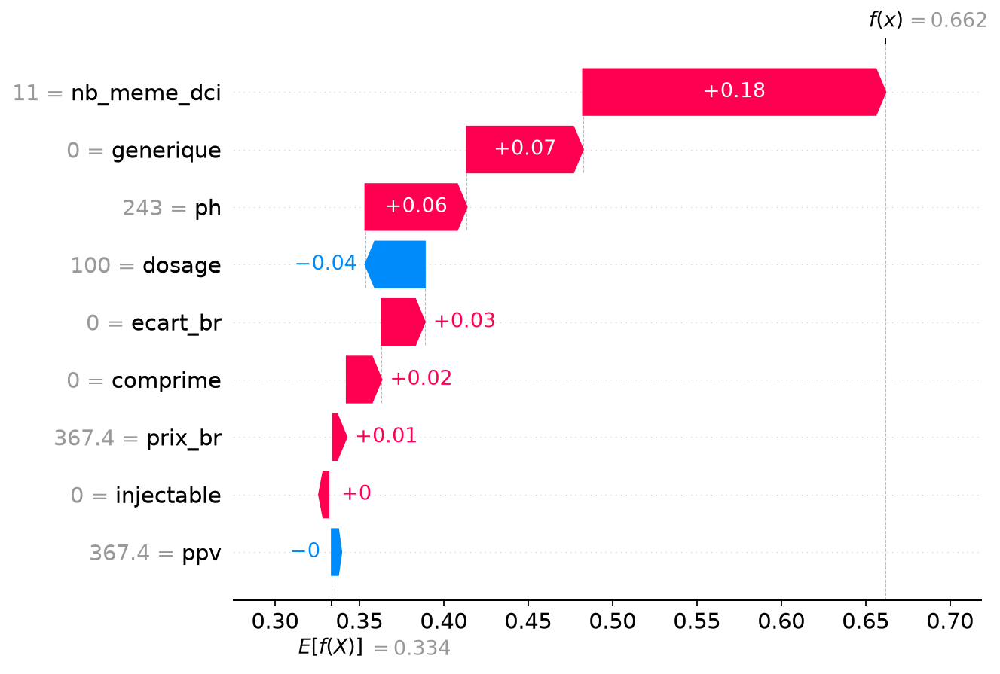
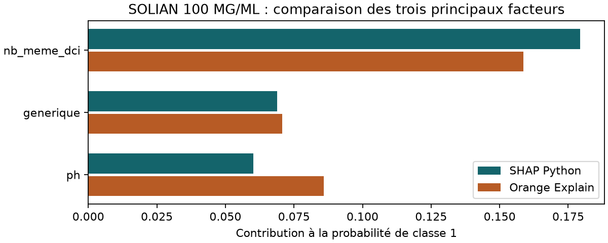

# Phase F — Explicabilité et audit

Sauf indication contraire, les mesures portent sur la forêt de référence V1 chargée depuis le registre MLflow. La classe 1 désigne une présentation non remboursée.

## F1 — Importance globale

| Rang | Permutation sur le test, baisse du F1 | MDI, réduction d'impureté |
|---:|---|---|
| 1 | nb_meme_dci · 0,263217 | nb_meme_dci · 0,279866 |
| 2 | dosage · 0,160679 | dosage · 0,165141 |
| 3 | generique · 0,067422 | ppv · 0,139787 |

La permutation perturbe une variable à la fois, dix fois avec G, et mesure la baisse de F1 sur le test. La MDI agrège le gain d'impureté aux nœuds pendant l'entraînement et peut donner plus de poids aux variables ayant beaucoup de seuils possibles. Les prix sont liés entre eux, ce qui peut aussi réduire l'effet observé quand un seul prix est permuté. [Valeurs complètes](f1-resultat.json)

## F2 — PDP et ICE

Sur la grille du graphique, la moyenne prédite pour `nb_meme_dci` descend globalement de **0,548 à 0,126** entre 1 et 99 présentations. Pour `ppv`, elle baisse de **0,436 à 0,315** entre environ 12 et 1 025 MAD, avec des variations locales. Les ICE ne sont pas parallèles. Entre les deux extrémités de la grille PPV, le 10e percentile des écarts individuels vaut **−0,258**, alors que le 90e vaut **+0,010**. La réponse du modèle à un prix dépend donc des autres caractéristiques de la ligne. Ces courbes décrivent le modèle et peuvent explorer des combinaisons de prix qui ne se rencontrent pas dans le référentiel. [Grilles et quantiles](f2-resultat.json)

## F3 — Médicament personnel

**SOLIAN 100 MG/ML**, DCI **AMISULPRIDE**, CODE **6118010120312**, est au rang 64 parmi les présentations non remboursées.

| Variable | Valeur | Variable | Valeur |
|---|---:|---|---:|
| ppv | 367,4 | ph | 243 |
| prix_br | 367,4 | ecart_br | 0 |
| dosage | 100 | generique | 0 |
| nb_meme_dci | 11 | injectable | 0 |
| comprime | 0 | | |

La probabilité de classe 1 est **0,661805**. Au seuil 0,5, la forêt prédit **1**, la classe observée. [Entrées et prédiction](f3-resultat.json)

## F4 — Attribution SHAP

La valeur de base est **0,333632**. Les trois plus fortes contributions absolues sont **nb_meme_dci +0,179306**, **generique +0,068827** et **ph +0,060190**. La somme des neuf contributions vaut **0,328173**. La base plus cette somme vaut **0,661805**, ce qui reproduit la probabilité. [Décomposition complète](f4-resultat.json)

## F5 — Message au gestionnaire

Le modèle estime à 66,2 % la probabilité que cette présentation ne soit pas remboursée. Le nombre de présentations de la même molécule, le statut princeps et le prix hospitalier sont les principaux éléments qui font monter cette estimation et justifient d'examiner le dossier.

## F6 — Contrefactuels

Inverser uniquement le statut de princeps à générique ramène la probabilité de **0,661805 à 0,298520**. Modifier ce statut sans modifier le produit ne constitue pas une intervention réaliste sur une présentation existante. Un scénario plausible à étudier est une baisse administrative du PPV de **367,40 à 330,66 MAD**, à prix de base constant, avec l'écart recalculé à **−36,74 MAD**. Le modèle donne alors **0,644179**. [Scénarios et scores](f6-resultat.json)

## F7 — Stabilité LIME

| Signe sur les cinq graines G à G+4 | Variables |
|---|---|
| Toujours positif | ph, prix_br, ecart_br, nb_meme_dci, injectable, comprime |
| Toujours négatif | ppv, dosage |
| Variable | generique · −, −, +, −, + |

Le voisinage tiré par LIME change entre les graines. Je retiens le sens stable des principales contributions comme recoupement et signale que le signe de `generique` est instable dans cette approximation locale. [Cinq essais, poids et R² locaux](f7-resultat.json)

## F8 — Équité par groupe

| Forêt | Groupe | Prédit classe 1 | Fausses alertes |
|---|---|---:|---:|
| Avec generique | Générique | 16,53 % | 3,74 % |
| Avec generique | Princeps | 40,05 % | 11,32 % |
| Sans generique | Générique | 15,84 % | 4,10 % |
| Sans generique | Princeps | 37,00 % | 10,85 % |

L'écart de taux de classe 1 passe de **23,52 à 21,16 points**. L'écart de fausses alertes passe de **7,58 à 6,75 points**. Des variables corrélées au statut ou des distributions de dossiers différentes peuvent maintenir des écarts. Un taux de fausses alertes supérieur signifie davantage de dossiers princeps réellement remboursés signalés à tort, donc davantage de travail pour les gestionnaires et d'examens injustifiés pour les acteurs concernés. [Mesures Fairlearn](f8-resultat.json)

## F9 — Fuite potentielle par la base de remboursement

Si la prédiction a lieu avant la procédure, `PRIX_BR` n'est pas encore connu. L'utiliser à ce moment crée une fuite temporelle potentielle, également présente dans `ecart_br` qui en dérive. Retirer les deux variables fait passer le F1 de **0,769902 à 0,769231**, soit **−0,000671** sur ce test. Une version destinée à l'amont pourrait les supprimer avec un faible coût mesuré ici. [Comparaison sur le même test](f9-resultat.json)

## F10 — Modèles lisibles

| Modèle | F1 classe 1 |
|---|---:|
| Forêt de référence | 0,769902 |
| Logistique standardisée | 0,512438 |
| Arbre de profondeur 2 | 0,389685 |

Le coefficient standardisé de `generique` est **−0,179903**. Le rapport de cotes est **0,8354** pour +1 écart-type et **0,6977** en passant de princeps à générique avec les autres variables fixes. L'arbre prédit 1 quand **nb_meme_dci ≤ 12,5** et **dosage ≤ 0,19**. Les autres feuilles prédisent 0. L'écart de F1 est compatible avec des interactions et des effets de seuil mieux représentés par la forêt sur ce jeu de test. [Coefficient et règles complètes](f10-resultat.json)

## F11 — Comparaison avec Orange Explain

Orange Explain Prediction donne **0,661805** pour la classe 1. Les deux premières contributions absolues sont **nb_meme_dci +0,158587** et **ph +0,085829**. SHAP en Python place **nb_meme_dci** en tête et **generique** en deuxième. Orange utilise un ensemble de référence issu du jeu d'entraînement, ce qui change la valeur de base (0,328908 au lieu de 0,333632). Les méthodes de traitement des variables dépendantes ou les valeurs retenues pour le fond de l'explainer peuvent aussi redistribuer les contributions entre prix et statut sans changer la prédiction. [Sortie Explain](f11-orange-explain.json) · [Rejeu du widget Canvas](f11-canvas.json)

